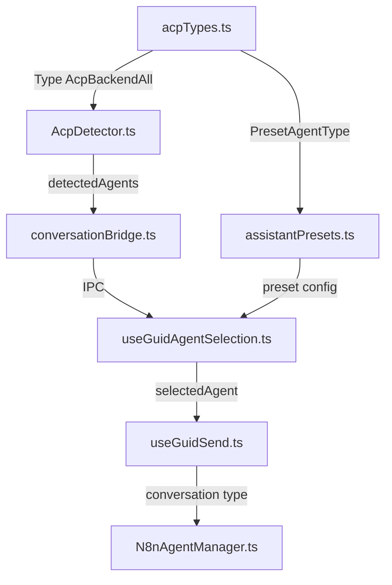

# Architecture du système d'activation des workflows n8n

## 🏗️ Vue d'ensemble

Le système d'intégration n8n dans AionUi suit une architecture multi-processus Electron avec trois couches distinctes:

```
┌─────────────────────────────────────────────────────────────┐
│                     ELECTRON MAIN PROCESS                     │
│                    (Node.js - Backend)                        │
├───────────────────────────────────────────────────────────────┤
│                                                                │
│  ┌─────────────────┐    ┌──────────────────┐                │
│  │  AcpDetector    │───▶│  ProcessConfig   │                │
│  │  (startup)      │    │  (electron-store)│                │
│  └─────────────────┘    └──────────────────┘                │
│          │                                                     │
│          ├─ initialize() au démarrage                         │
│          ├─ Scan POTENTIAL_ACP_CLIS                          │
│          ├─ Ajout backends built-in (gemini, n8n)            │
│          └─ Stockage dans detectedAgents[]                    │
│                                                                │
│  ┌──────────────────────────────────────────────────────┐   │
│  │            IPC Bridge (preload.ts)                     │   │
│  │  • acpConversation.getAvailableAgents.invoke()        │   │
│  │  • conversation.create.invoke({ type: 'n8n', ... })   │   │
│  └──────────────────────────────────────────────────────┘   │
│                          ▲                                     │
└──────────────────────────┼─────────────────────────────────────┘
                           │ IPC
┌──────────────────────────▼─────────────────────────────────────┐
│                  ELECTRON RENDERER PROCESS                      │
│                    (Chromium - Frontend)                        │
├─────────────────────────────────────────────────────────────────┤
│                                                                  │
│  ┌────────────────────────────────────────────────────┐        │
│  │              GuidPage.tsx (Page d'accueil)          │        │
│  │  • Coordonne les hooks                               │        │
│  │  • Affiche la liste des assistants                  │        │
│  │  • Gère l'interaction utilisateur                    │        │
│  └────────────────────────────────────────────────────┘        │
│           │                   │                  │              │
│           ▼                   ▼                  ▼              │
│  ┌──────────────┐   ┌──────────────┐   ┌──────────────┐      │
│  │useGuidAgent  │   │useGuidModel  │   │useGuidSend   │      │
│  │Selection     │   │Selection     │   │              │      │
│  └──────────────┘   └──────────────┘   └──────────────┘      │
│           │                                     │              │
│           ▼                                     ▼              │
│  • Récupère availableAgents via IPC    • handleSend()         │
│  • Filtre/sélectionne assistant        • Crée conversation    │
│  • État: selectedAgentKey = 'n8n'      • Navigation /conv/{id}│
│                                                                  │
└─────────────────────────────────────────────────────────────────┘
```

## 📊 Flux de données détaillé

### 1. Démarrage de l'application

```
Electron app.whenReady()
  │
  ├─> initAgent()
  │     └─> AcpDetector.initialize()
  │           │
  │           ├─ Scan des CLI installés (claude, qwen, etc.)
  │           │   • Utilise `which`/`where` pour détecter
  │           │   • Vérifie POTENTIAL_ACP_CLIS
  │           │
  │           ├─ Ajout backends built-in (SANS CLI)
  │           │   • gemini (Google API native)
  │           │   • n8n (HTTP backend sur port 3458)        ✅ CRITIQUE
  │           │   • n8n-multi-workflow (HTTP backend)       ✅ CRITIQUE
  │           │
  │           ├─ Ajout custom agents depuis config
  │           │   • Lecture de acp.customAgents
  │           │   • builtin-n8n-workflow (preset)
  │           │   • builtin-n8n-multi-workflow (preset)
  │           │
  │           └─ Stockage: this.detectedAgents = [...]
  │
  └─> createWindow()
        └─> Renderer process démarre
              └─> GuidPage.tsx monte
```

### 2. Chargement de la page d'accueil

```
GuidPage.tsx mounts
  │
  ├─> useGuidAgentSelection() hook
  │     │
  │     ├─ useSWR('acp.agents.available')
  │     │   └─> IPC: acpConversation.getAvailableAgents.invoke()
  │     │         └─> Main: AcpDetector.getDetectedAgents()
  │     │               └─> Returns: detectedAgents[] array
  │     │
  │     ├─ useEffect: setAvailableAgents(availableAgentsData)
  │     │   └─> State update triggers re-render
  │     │
  │     ├─ useState: selectedAgentKey
  │     │   └─> DÉFAUT: 'n8n'                               ✅ LIGNE CRITIQUE 133
  │     │   └─> Peut être override par ConfigStorage.get('guid.lastSelectedAgent')
  │     │
  │     └─ useMemo: selectedAgentInfo
  │         └─> findAgentByKey(selectedAgentKey)
  │               └─> Recherche dans availableAgents
  │
  ├─> useGuidModelSelection() hook
  │     └─> Gère la liste des modèles (Gemini, Claude, etc.)
  │
  └─> useGuidSend() hook
        └─> handleSend() - appelé au clic "Envoyer"
```

### 3. Clic sur "Envoyer" (Flux normal attendu)

```
User clicks "Envoyer" button
  │
  ├─> GuidPage: send.sendMessageHandler()
  │     └─> useGuidSend: handleSend()
  │           │
  │           ├─ Vérification: selectedAgent === 'n8n' ?
  │           │   └─> OUI ✅
  │           │
  │           ├─ Création placeholder model
  │           │   {
  │           │     id: 'n8n-placeholder',
  │           │     name: 'n8n',
  │           │     useModel: 'n8n-workflow',
  │           │     platform: 'n8n'
  │           │   }
  │           │
  │           ├─> IPC: conversation.create.invoke({
  │           │     type: 'n8n',
  │           │     name: input,
  │           │     model: placeholderModel,
  │           │     extra: { ... }
  │           │   })
  │           │     │
  │           │     └─> Main: conversationBridge.create()
  │           │           └─> N8nAgentManager.start()
  │           │                 └─> HTTP request to http://localhost:3458
  │           │
  │           ├─ Stocke initial message dans sessionStorage
  │           │   key: `n8n_initial_message_${conversation.id}`
  │           │
  │           └─> navigate(`/conversation/${conversation.id}`)
  │                 └─> React Router navigation
  │
  └─> Renderer affiche N8nChat.tsx
```

### 4. Clic sur "Envoyer" (Flux actuel PROBLÉMATIQUE)

```
User clicks "Envoyer" button
  │
  ├─> GuidPage: send.sendMessageHandler()
  │     └─> useGuidSend: handleSend()
  │           │
  │           ├─ Vérification: selectedAgent === 'n8n' ?
  │           │   └─> NON ❌
  │           │   └─> selectedAgent === 'custom' ou autre
  │           │
  │           ├─ Passe dans la branche ACP path (ligne ~270)
  │           │   au lieu de n8n path (ligne 179)
  │           │
  │           ├─ Tente de créer conversation ACP
  │           │   └─> ÉCHEC: n8n n'est pas un backend ACP CLI
  │           │
  │           └─ Bouton tourne indéfiniment, aucune navigation
```

## 🔍 Points de défaillance identifiés

### Défaillance #1: AcpDetector n'ajoute pas n8n

**Fichier**: `src/agent/acp/AcpDetector.ts`  
**Méthode**: `initialize()`  
**Ligne**: ~105-115

**Code actuel (commit ec247856)**:
```typescript
detected.push({
  backend: 'n8n',
  name: 'n8n Workflow',
  cliPath: undefined,
});
```

**Problème potentiel**:
- Code ajouté mais non compilé dans `out/main/index.js`
- Processus Electron utilise ancien `out/main/index.js`
- `detectedAgents` ne contient pas n8n

**Test de vérification**:
```powershell
Select-String -Path "out\main\index.js" -Pattern "n8n-multi-workflow"
```

### Défaillance #2: Type union incomplet

**Fichier**: `src/types/acpTypes.ts`  
**Type**: `AcpBackendAll`  
**Ligne**: 24

**Code actuel (commit ec247856)**:
```typescript
export type AcpBackendAll =
  | 'claude'
  | 'gemini'
  // ...
  | 'n8n'                    // ✅ Ajouté
  | 'n8n-multi-workflow'     // ✅ Ajouté
  | 'custom';
```

**Problème potentiel**:
- TypeScript compilé avec ancien type
- Runtime type check échoue
- `selectedAgent` ne peut jamais être `'n8n'`

### Défaillance #3: selectedAgentKey initial incorrect

**Fichier**: `src/renderer/pages/guid/hooks/useGuidAgentSelection.ts`  
**Hook**: `useGuidAgentSelection`  
**Ligne**: 133

**Code actuel (commit ec247856)**:
```typescript
const [selectedAgentKey, _setSelectedAgentKey] = useState<string>('n8n');
```

**Code compilé hypothétique (NON VÉRIFIÉ)**:
```typescript
const [selectedAgentKey, _setSelectedAgentKey] = useState<string>('custom:builtin-n8n-workflow');
```

**Problème potentiel**:
- Hot reload Vite ne met pas à jour le hook
- Renderer utilise ancien bundle
- État initial reste `'custom:builtin-n8n-workflow'`

### Défaillance #4: useGuidSend branche manquante

**Fichier**: `src/renderer/pages/guid/hooks/useGuidSend.ts`  
**Callback**: `handleSend`  
**Ligne**: 179-219

**Code actuel (commit ec247856)**:
```typescript
// n8n path
if (selectedAgent === 'n8n' || (isPreset && finalEffectiveAgentType === 'n8n')) {
  // ... création conversation n8n
}
```

**Problème potentiel**:
- Condition jamais vraie si `selectedAgent !== 'n8n'`
- Tombe dans branche ACP par défaut (ligne ~270)
- Échec de création de conversation

## 🔗 Dépendances entre composants

### Chaîne de dépendances critiques

```
AcpDetector.detectedAgents[]
  ↓
IPC: getAvailableAgents.invoke()
  ↓
useGuidAgentSelection: availableAgents
  ↓
useGuidAgentSelection: selectedAgentKey (useState initial)
  ↓
useGuidSend: selectedAgent (dérivé de selectedAgentKey)
  ↓
useGuidSend: handleSend() branche n8n
  ↓
conversation.create({ type: 'n8n' })
```

**Rupture à n'importe quel maillon = échec complet**

### Fichiers interdépendants



## 💾 Stockage des données

### Electron Store (config.json)
```json
{
  "guid.lastSelectedAgent": "n8n",  // Override du défaut useState
  "acp.customAgents": [
    {
      "id": "builtin-n8n-workflow",
      "name": "n8n Workflow",
      "enabled": true,
      "isPreset": true,
      "presetAgentType": "n8n"
    }
  ]
}
```

### SessionStorage (Browser)
```javascript
// Clé temporaire pour message initial
sessionStorage.setItem(
  `n8n_initial_message_${conversationId}`,
  JSON.stringify({ input, files })
);
```

### Database (SQLite)
```sql
-- conversations table
CREATE TABLE conversations (
  id TEXT PRIMARY KEY,
  type TEXT,  -- 'gemini', 'acp', 'n8n', 'n8n-multi-workflow'
  name TEXT,
  model TEXT,
  extra TEXT  -- JSON contenant configuration
);
```

## 🚀 Cycle de build

### Développement (electron-vite dev)
```
1. TypeScript transpilation (tsc)
   src/*.ts → out/*.js
   
2. Vite bundling (renderer)
   src/renderer/*.tsx → dev server (http://localhost:5173)
   
3. Electron main process
   Charge out/main/index.js
   
4. Hot Module Replacement (HMR)
   Vite surveille src/renderer/*
   Auto-reload sur changement
```

**PROBLÈME**: HMR ne fonctionne pas pour Main Process  
**SOLUTION PARTIELLE**: Redémarrage complet requis après changement Main

### Production (npm run build)
```
1. electron-vite build
   • Minification
   • Tree-shaking
   • Source maps (optionnel)
   
2. Output: dist/
   dist/main/
   dist/renderer/
   dist/preload/
   
3. electron-builder
   → E-audit Setup.exe (Windows)
```

## 🧪 Points de test

### Test 1: AcpDetector contient n8n
```typescript
const agents = acpDetector.getDetectedAgents();
expect(agents.find(a => a.backend === 'n8n')).toBeDefined();
```

### Test 2: availableAgents inclut n8n
```typescript
const result = await ipcBridge.acpConversation.getAvailableAgents.invoke();
expect(result.data.some(a => a.backend === 'n8n')).toBe(true);
```

### Test 3: selectedAgentKey défaut = 'n8n'
```typescript
const { result } = renderHook(() => useGuidAgentSelection({...}));
expect(result.current.selectedAgentKey).toBe('n8n');
```

### Test 4: handleSend crée conversation n8n
```typescript
await act(async () => {
  await result.current.handleSend();
});
expect(mockCreate).toHaveBeenCalledWith(
  expect.objectContaining({ type: 'n8n' })
);
```

---

**Dernière mise à jour**: 18/11/2026 16:15
